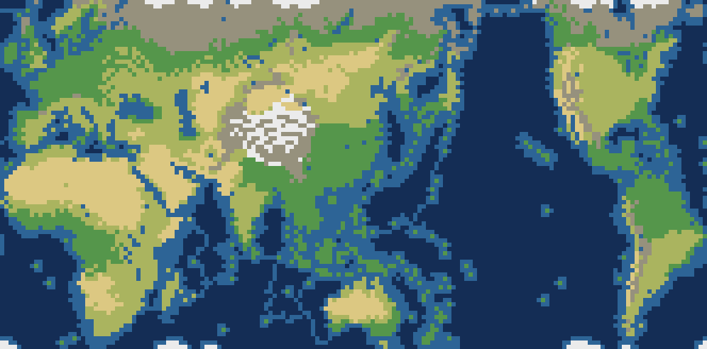

# noly的文明6 / Noly's Civ6

这是一个 Civilization VI 的 Mod 合集，包含一个 TSL 世界地图和一个中国领袖 mod。

A small Civilization VI mod collection containing a TSL world map and a Chinese leader mod.

## 包含的 Mod / Included mods

| Mod | 内容 | 作者 |
|---|---|---|
| `NolyWorldMap` | 基于 7676World 的 166×82 TSL 世界地图 | noly（基于 7676） |
| `PhantagonistLiuChe` | 汉武帝刘彻，作为中国的可选领袖 | Phantagonist |

`PhantagonistLiuChe` 是第三方 Steam Workshop mod（Workshop ID 2187130106），本仓库只是个人备份/合集，不代表原作者。



## NolyWorldMap（世界地图）

一个基于 **7676World** 的 Civilization VI TSL 世界地图，调整了太平洋/大西洋宽度，并新增了白令海陆桥、小岛和阿拉斯加。

A Civilization VI TSL world map based on **7676World**, with a wider Pacific, a slightly wider Atlantic, and a new Bering land bridge / Alaska / Aleutian islands.

### 特点 / Features

- 尺寸 **166 × 82**，偶数宽度，横向圆柱环绕。
- **太平洋显著加宽**：约 23 格（7676 原版约 10 格）。
- **大西洋约 7 格**：7676 原版的 1.2 倍。
- 陆地 **6,153 格**（在 7676 基础上新增白令陆桥、阿拉斯加和小岛共 29 格）。
- 浅水 **2,743 格**，深水 **4,716 格**。
- 海洋资源 **2,634** 条，TSL **158** 个，水上出生点只有毛利。
- 保留了 7676 大部分陆地形状、海岸/浅水分布和资源分布；没有全局重算海岸。
- 删除了太平洋中部两条人工残留的条状浅水，相关 4 条海产已移到附近自然浅水。
- 勘察加通过顶部陆桥与亚洲大陆连接，陆桥上增加丘陵、森林、雪地做自然修饰。
- 白令海蓝色岛保持不动，红色岛向下平移到蓝色岛南侧一格；浅水只围绕岛屿和踏脚路径，其他地方恢复深水，形成浅水/深水交错。
- 阿拉斯加为 4×3 小半岛，并向南延伸 2×2，方便早期探索；按现实风格使用苔原/雪地/森林，并放置石油、皮毛、鱼等资源。
- 堪察加、库页岛、千岛群岛、北海道、南美、爱尔兰等位置按 7676 修正并保持完整。

> 说明：太平洋是整列加宽，因此白令海比 7676 宽；现在白令海内是浅水环岛 + 深水间隔的踏脚石布局，勘察加通过顶部陆桥与亚洲连接。
>
> TSL 说明：7676 原版为 157 个；当前地图为 158 个，多出的 `LEADER_PHANTA_LIU_CHE` 起始点是游戏/模组自动加入的领袖起始点，不是本次地图编辑新增的。

## 数据 / Map data

| 项目 | 数值 |
|---|---:|
| 尺寸 | 166 × 82 |
| 总格数 | 13,612 |
| 陆地 | 6,153 |
| 浅水 | 2,743 |
| 深水 | 4,716 |
| 海洋资源 | 2,634 |
| TSL | 158 |
| 水上出生点 | 1（毛利） |

## 依赖 / Requirements

- **Civilization VI**
- **Gathering Storm**（两个 mod 都需要）
- **Rise and Fall**（`PhantagonistLiuChe` 需要）
- 建议安装与 7676 相同的 DLC/文明包，否则部分 TSL 可能无效或不出生。

## 安装 / Installation

1. 安装 Civ6、Gathering Storm 和 Rise and Fall。
2. 将本仓库中的 **两个文件夹** 都复制到：
   ```
   Documents\My Games\Sid Meier's Civilization VI\Mods\
   ```
   最终结构应为：
   ```
   Mods\NolyWorldMap\NolyWorldMap.modinfo
   Mods\NolyWorldMap\Maps.xml
   Mods\NolyWorldMap\Maps\NolyWorld.Civ6Map

   Mods\PhantagonistLiuChe\PhantagonistLiuChe.modinfo
   Mods\PhantagonistLiuChe\...
   ```
3. 启动游戏，在 Mod 列表中同时启用 **noly的世界地图** 和 **Phantagonist's Liu Che**。
4. **新开一局**：
   - 地图类型选择 **「noly的世界地图」**；
   - 选择中国时，领袖可选 **刘彻（汉武帝）**。

> 旧存档保存的是旧地图数据，不会自动更新；每次更新地图后都必须新开一局。

## 文件结构 / Repository layout

```
noly-civ6/
├─ README.md
├─ NOTICE.md
├─ preview.png
├─ .gitignore
├─ NolyWorldMap/
│  ├─ NolyWorldMap.modinfo
│  ├─ Maps.xml
│  └─ Maps/
│     └─ NolyWorld.Civ6Map
└─ PhantagonistLiuChe/
   ├─ PhantagonistLiuChe.modinfo
   ├─ GameData/
   ├─ Localization/
   ├─ Textures/
   └─ ...
```

## 版本 / Version

- 2026-11-07：166×82，太平洋 +4 格，删除两条残留浅水条。
- 2026-11-07：白令海编辑：勘察加顶部陆桥、阿留申小岛、3×2 阿拉斯加、勘察加—阿拉斯加浅水通道。
- 2026-11-07：白令海 v2：陆桥加丘陵/森林/雪地修饰、绿色区域改为大片浅水、阿拉斯加扩大为 4×3。
- 2026-11-07：白令海 v3：两岛一上一下、浅水围绕岛屿/踏脚路径、其余恢复深水；阿拉斯加向南延伸 2×2。
- 2026-11-07：白令海 v4：蓝色岛不动，红色岛向下平移到蓝色岛南侧一格，浅水/深水按新位置重算。
- 2026-11-07：仓库改名 **noly-civ6**，加入 **Phantagonist's Liu Che（汉武帝）** mod。
- 基于 7676World 的 TSL 世界地图修改。

## 致谢 / Credits

- 原版地图：**7676World**，作者 **7676**（Steam Workshop）。
- 本仓库不包含原版 7676World 地图文件，只包含修改后的 `NolyWorldMap`。
- **PhantagonistLiuChe**：作者 **Phantagonist**（Steam Workshop ID 2187130106），本仓库只做个人备份/合集。
- 地图修改与整理：noly。

## 使用说明 / Notice

- 仅供个人游戏使用。
- 转载/再分发请保留对 **7676**、**Phantagonist** 和 **noly** 的署名，并遵守各自原 mod 的使用条款。
- `PhantagonistLiuChe` 是第三方 mod，版权归 Phantagonist；如果仓库改为公开，请先确认原作者是否允许再分发。
- 商业使用或再分发需获得原作者许可。
